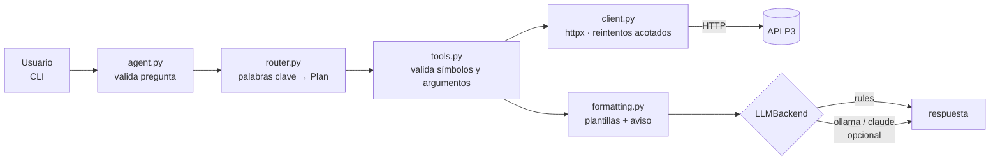

# 🤖 Agente analista de mercado

Proyecto 4 del portafolio de finanzas. Un agente de línea de comandos que responde **en español** preguntas sobre el mercado («¿cuál fue la mejor acción del mes?», «¿qué volatilidad se espera para NVDA?», «resumen por sector») consumiendo **solo** la API propia del [proyecto 3](../03-api-mercado). No usa Yahoo ni ningún dato externo.

> **Regla de diseño:** el agente habla únicamente con P3 por HTTP. El LLM (opcional) es una dependencia externa aislada detrás de la interfaz `LLMBackend`; por defecto **no hay LLM y el costo es cero**.

## 🏗️ Arquitectura



| Módulo | Responsabilidad |
|---|---|
| `agente/client.py` | Cliente de P3: lectura en streaming con tope de 2 MB, timeout por operación y plazo total, hasta 2 reintentos (solo red/timeout y 502-504), errores `{"error":{code,message,details,request_id}}` convertidos a `ToolError` |
| `agente/tools.py` | Una herramienta por endpoint: tickers, precios, métricas, ranking, sectores, predicción de volatilidad, info del modelo |
| `agente/router.py` | Enruta la pregunta a una herramienta (sin LLM) |
| `agente/formatting.py` | Plantillas en español; sanea el texto que viene de la API |
| `agente/llm.py` | `LLMBackend`: `rules` (default), `ollama`, `claude` |
| `agente/agent.py` / `cli.py` | Orquestación y CLI |

Los endpoints están **cableados a mano** según `03-api-mercado/app/routers/*.py` (P3 no publica `/docs` ni `/openapi.json` en producción).

## ▶️ Cómo correrlo

```bash
python -m venv .venv && . .venv/bin/activate     # Windows: .venv\Scripts\activate
pip install -r requirements-dev.txt

export P3_BASE_URL=http://127.0.0.1:8000          # URL de la API P3 (default)
# export P3_API_KEY=...                            # opcional; nunca se imprime ni se loguea

python -m agente "¿Cuál fue la mejor acción del mes?"
python -m agente                                   # modo interactivo ('salir' para terminar)
```

Preguntas que entiende: mejor/peor acción del mes, trimestre o año; la más/menos volátil; mejor Sharpe; predicción de volatilidad de un símbolo; resumen por sector; precio y métricas de uno a tres símbolos; lista de acciones; datos del modelo.

**Códigos de salida** (modo de una sola pregunta): `0` respondida; `1` la consulta no se pudo responder (error de API o red, pregunta vacía, demasiado larga o no entendida, símbolo desconocido); `2` configuración o uso incorrecto (p. ej. `P3_TIMEOUT=abc`, backend mal configurado, argumentos inválidos). El modo interactivo termina siempre con `0`. Rangos de configuración: `P3_TIMEOUT` 0,1–120 s (por operación de red), `P3_TOTAL_TIMEOUT` 1–300 s (plazo total de una consulta, por defecto 30), `P3_RETRIES` 0–5. `P3_BASE_URL` y `OLLAMA_URL` deben ser http(s) sin credenciales incrustadas, espacios ni caracteres de control; si no, error de configuración (código 2).

### Backends

| Backend | Qué hace | Requisitos |
|---|---|---|
| `rules` (default) | Sin LLM: enrutado por palabras clave y respuesta con plantillas | Nada |
| `ollama` | Ollama local redacta la respuesta a partir de los datos ya obtenidos | `OLLAMA_URL`, `OLLAMA_MODEL` |
| `claude` | API de Anthropic, import perezoso | `pip install anthropic` y `ANTHROPIC_API_KEY` en el entorno (modelo: `AGENTE_CLAUDE_MODEL`) |

Se elige con `--backend` o `AGENTE_BACKEND`. En los backends con LLM, **el enrutado y las llamadas a P3 siguen siendo deterministas**: el LLM solo redacta con los hechos ya obtenidos (en un bloque `<datos>` marcado como dato, no instrucciones). Si el LLM falla, se muestra la respuesta de plantilla.

## 🧪 Pruebas

```bash
ruff check .
pytest -q          # P3 simulada con httpx.MockTransport: sin red
```

Cubren cada herramienta, el enrutado, errores de P3 (404/422/429/503), reintentos acotados, API caída y timeouts, símbolos inválidos/inyección de ruta, saneado del texto de la API, backends (Ollama simulado; Claude solo comprueba su configuración, nunca llama a la red) y el CLI.

**Prueba e2e opcional contra una P3 real** (se omite si no hay `P3_E2E_URL`):

```bash
# 1) levantar P3 (ver ../03-api-mercado): alembic upgrade head && python -m app.etl --seed && uvicorn app.main:create_app --factory --port 8765
# 2) correr:
P3_E2E_URL=http://127.0.0.1:8765 pytest -q -m e2e      # PowerShell: $env:P3_E2E_URL="http://127.0.0.1:8765"
```

## 🔒 Seguridad

- Los símbolos se validan por formato **y** contra la lista de `/tickers` antes de armar la URL: nada que escriba el usuario llega a una ruta sin pasar por esa lista cerrada.
- Pregunta limitada a 500 caracteres; el cuerpo de las respuestas de P3 (también el de los errores) se lee en streaming y se aborta al superar 2 MB, o antes si `Content-Length` ya lo declara; sin seguir redirecciones (la clave no viaja a otro host).
- `P3_API_KEY` solo se envía como cabecera `X-API-Key` si está definida; no aparece en logs ni en `repr`.
- **Sin compresión:** se envía `Accept-Encoding: identity` y se rechaza (antes de leer nada) cualquier respuesta con `Content-Encoding` distinto de `identity`, de modo que una «bomba de descompresión» (gzip de ~1 MB que expande a 1 GB) no se descomprime nunca y el tope de 2 MB se mide sobre bytes reales.
- **Plazo total:** además del timeout por operación, toda consulta a P3 (reintentos incluidos) tiene un plazo total (`P3_TOTAL_TIMEOUT`). Se comprueba tras cada trozo recibido y antes de cada reintento, así que una respuesta «goteante» se corta con un error controlado; en el peor caso puede sobrepasarse por un timeout de lectura (`P3_TIMEOUT`), porque no se interrumpe una lectura ya bloqueada.
- **El texto de la API es dato:** los campos de texto se sanean con `clean()` (sin caracteres de control C0/C1 —incluido ESC—, separadores de línea Unicode ni marcas bidireccionales; largo acotado) y los numéricos (`rank`, `n_days`, `horizon_days`) solo se muestran si son enteros (si no, `n/d`). Los valores `null` y las listas/objetos en campos de texto se muestran como `n/d`. Esto incluye `code`, `message` y `request_id` de los errores. Los caracteres invisibles/bidireccionales se escriben con escapes (`​`…) en el código, nunca literales; un test lo vigila.
- **La salida del LLM también es dato:** se eliminan las secuencias ANSI/CSI/OSC y los caracteres de control (se conservan los saltos de línea) y se limita a 4000 caracteres. No se interpreta ni se usa para llamar herramientas.
- **Logs:** una línea por registro, sin saltos de línea ni ESC, y sin tracebacks (solo el tipo de excepción).
- Los errores se resumen en un mensaje claro; el stack trace nunca llega al usuario.

## ⚠️ Límites y resultados honestos

- El enrutado por palabras clave es frágil: preguntas con redacción muy distinta caen en el mensaje de ayuda. Es el precio de no depender de un LLM.
- Los ranking/retornos son lo que calcula P3 sobre su historial (2015-2025 en el seed); el agente no recalcula nada.
- La predicción viene del modelo del proyecto 2 (regresión logística, AUC en test ≈ 0,65 frente a ≈ 0,63 de la referencia HAR-RV): una ventaja **modesta**. Cuando la fecha cae dentro de la muestra de entrenamiento (`in_sample`), el agente lo advierte explícitamente.
- Las métricas de «volatilidad» y «Sharpe» no implican «mejor»: el ranking informa el primero según el orden pedido.
- Las consultas de métricas usan todo el historial; aún no se interpreta «este mes» para un ticker concreto.
- Los backends `ollama` y `claude` no se probaron contra servicios reales (ver abajo).

## Datos y aviso de uso

Los datos provienen de la API P3, que a su vez los obtiene de Yahoo Finance vía `yfinance` (sin afiliación con Yahoo; uso educativo y no comercial; los términos de Yahoo aplican a los datos). La licencia MIT cubre el código, no los datos. Las respuestas del agente son informativas y **no constituyen asesoría ni recomendación de inversión**.

## Licencia

MIT — ver [LICENSE](LICENSE).
